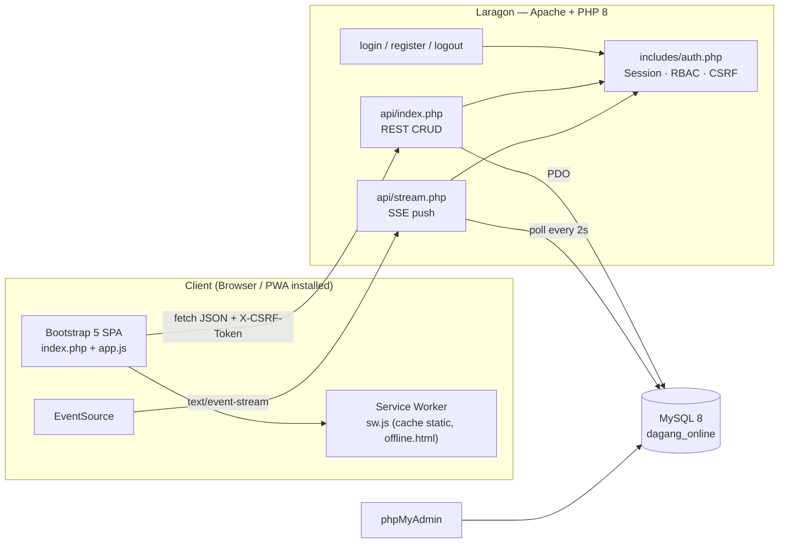
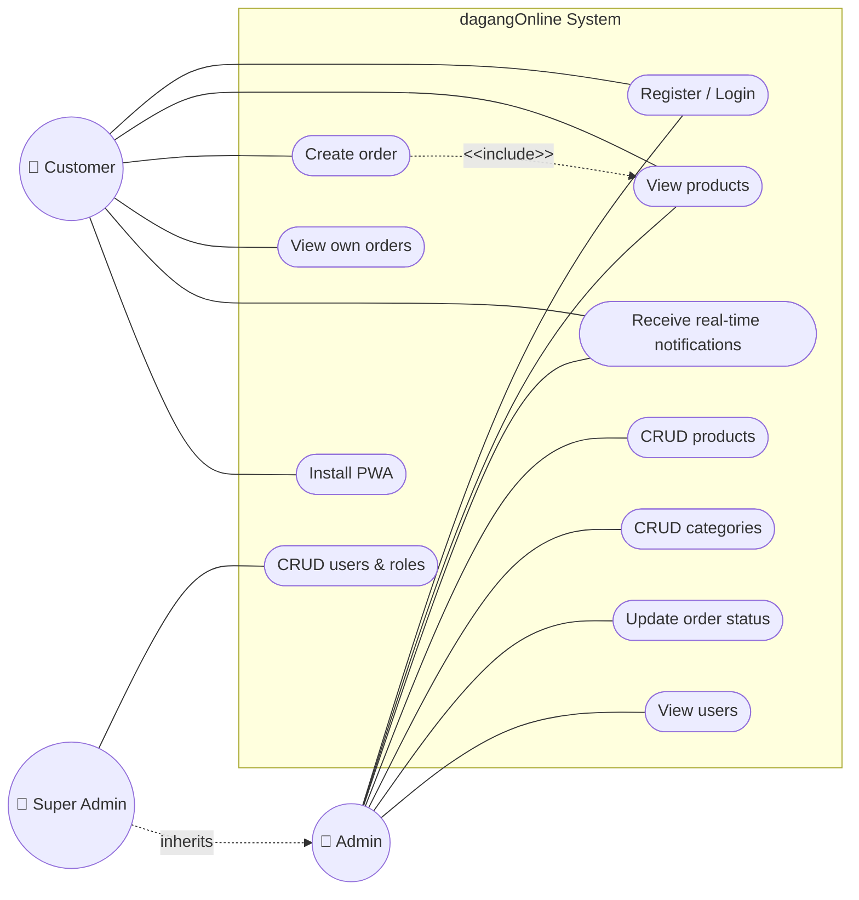
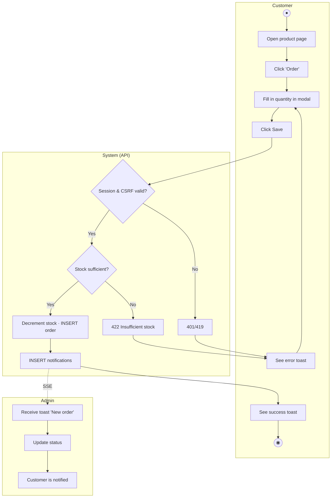
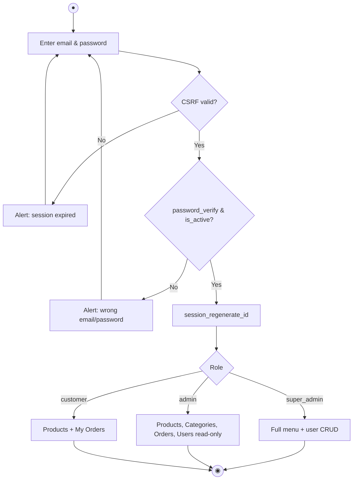
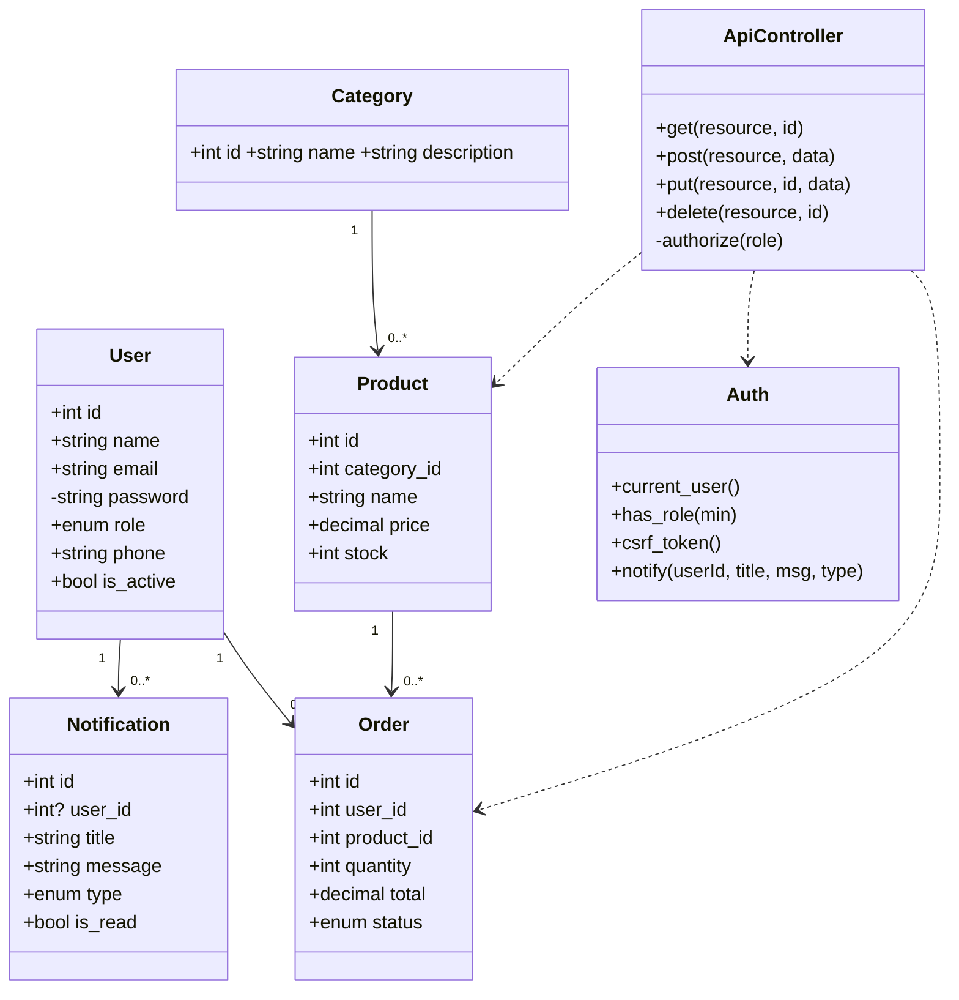
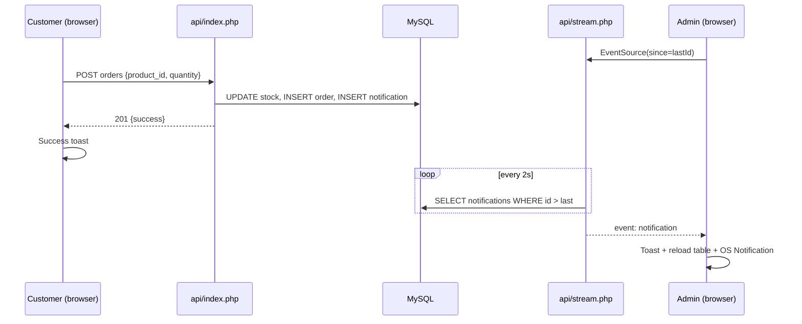
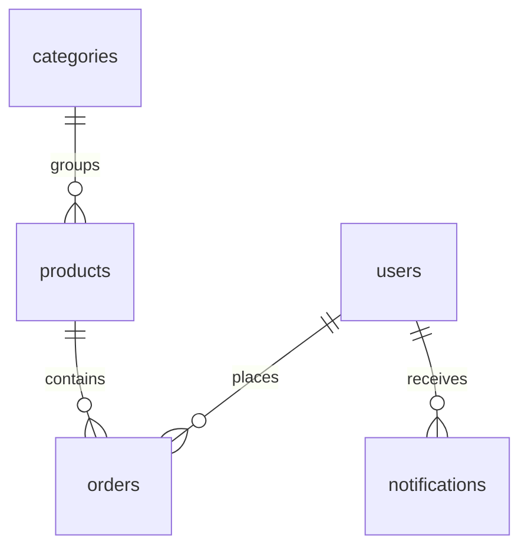

# dagangOnline — PHP Native Edition

**Developed by NussCorp Technologies**

A light-theme PWA for UMKM commerce, built with **native PHP 8.1+, Bootstrap 5.3, and MySQL 8**. It runs on Laragon (Apache + MySQL + phpMyAdmin). It provides role-based CRUD for **Super Admin, Admin, and Customer**, a REST API, real-time notifications over Server-Sent Events, and Bootstrap modals, toasts, and alerts for every action.

> This lives in `php-native/` beside the existing ASP.NET Core app, so the two stacks stay independent.

---

## 1. Installation (Laragon)

1. Start **Apache** and **MySQL** in Laragon.
2. Create the database: open **phpMyAdmin** → *Import* → choose `database/schema.sql`. Or use the CLI:
   ```bash
   mysql -uroot < database/schema.sql
   ```
3. Create the demo accounts (passwords are hashed with `password_hash`):
   ```bash
   php database/seed_users.php
   ```
4. Expose the folder in Laragon's `www`. Run this in an admin PowerShell:
   ```powershell
   New-Item -ItemType Junction -Path C:\laragon\www\dagangonline-php -Target <repo>\php-native
   ```
5. Open `http://localhost/dagangonline-php/`.

| Role | Email | Password |
|---|---|---|
| Super Admin | superadmin@nusscorp.test | password123 |
| Admin | admin@nusscorp.test | password123 |
| Customer | customer@nusscorp.test | password123 |

Change these passwords before any deployment. You can override the DB settings with the `DB_HOST`, `DB_NAME`, `DB_USER`, and `DB_PASS` environment variables (`config/database.php`).

> **Real-time note:** `api/stream.php` keeps its connection open for 25 seconds. `php -S` handles only one request at a time on Windows, so use Laragon's Apache for the real-time features.

---

## 2. Folder structure

```
php-native/
├── api/
│   ├── index.php        # REST API (GET/POST/PUT/PATCH/DELETE)
│   └── stream.php       # SSE real-time notifications
├── assets/{css,js,icons}
├── config/database.php  # PDO connection
├── database/
│   ├── schema.sql       # DDL + seed categories/products
│   └── seed_users.php   # demo accounts
├── includes/{auth.php, head.php}
├── index.php            # SPA dashboard (Bootstrap 5)
├── login.php · register.php · logout.php
├── manifest.json · sw.js · offline.html   # PWA
└── docs/diagrams/       # tldraw files (.tldr)
```

---

## 3. REST API

Base: `api/index.php?resource={name}[&id={id}]`. All requests require a session. Every write must send the `X-CSRF-Token` header. Responses use the JSON format `{ success, message?, data? }`.

| Resource | GET | POST | PUT/PATCH | DELETE |
|---|---|---|---|---|
| `products` | all roles | admin+ | admin+ | admin+ |
| `categories` | all roles | admin+ | admin+ | admin+ |
| `orders` | customer: own orders only · admin+: all | all roles (stock decremented) | admin+ (status) | admin+ |
| `users` | admin+ | super_admin | super_admin | super_admin (cannot delete self) |
| `notifications` | own + broadcast (admin) | – | mark all as read | – |
| `stats` | dashboard summary | – | – | – |

Real time: `GET api/stream.php?since={lastId}` (EventSource, event `notification`). If the browser does not support SSE, the client falls back to polling every 5 seconds.

Example:
```bash
curl -b ck -X POST -H "X-CSRF-Token: <token>" -H "Content-Type: application/json" \
  -d '{"name":"Kopi","price":20000,"stock":5,"category_id":1}' \
  "http://localhost/dagangonline-php/api/index.php?resource=products"
```

---

## 4. Diagrams

The diagrams are written in Mermaid so they render directly on GitHub. To edit them on **tldraw.com**, see section 5.

### 4.1 System architecture (SDE)



### 4.2 Use case diagram



### 4.3 Activity diagram: customer order (swimlanes)



### 4.4 Activity diagram: login and RBAC



### 4.5 Class diagram (UML)



### 4.6 Sequence diagram: real-time notifications



### 4.7 ERD



---

## 5. Diagrams on tldraw.com

tldraw does not have an official Mermaid import, so you must create the `.tldr` files yourself:

1. Open https://www.tldraw.com → create a new board.
2. Redraw each diagram from section 4 (architecture, use case, activity, class, sequence, ERD).
3. **Menu → File → Save as** (or *Export → .tldr*), and save it to `docs/diagrams/` using these names:
   `architecture.tldr`, `use-case.tldr`, `activity-order.tldr`, `activity-login.tldr`, `class-uml.tldr`, `sequence-realtime.tldr`.
4. Optional: *Share → Copy link* and add the link to this table.

| Diagram | tldraw file | Share link |
|---|---|---|
| Architecture SDE | `docs/diagrams/architecture.tldr` | _(not yet)_ |
| Use case | `docs/diagrams/use-case.tldr` | _(not yet)_ |
| Activity: order | `docs/diagrams/activity-order.tldr` | _(not yet)_ |
| Activity: login | `docs/diagrams/activity-login.tldr` | _(not yet)_ |
| Class UML | `docs/diagrams/class-uml.tldr` | _(not yet)_ |
| Sequence realtime | `docs/diagrams/sequence-realtime.tldr` | _(not yet)_ |

---

## 6. UI/UX features

- **Light theme only** (`data-bs-theme="light"`, `color-scheme: light`).
- Responsive: the sidebar becomes an offcanvas on mobile, and tables turn into stacked cards below 576px.
- Every action has feedback: a create/edit **modal** with validation, a delete/logout **confirm modal**, success/error/warning **toasts**, an **alert** on login/register, a notification **badge** in the navbar, and an OS **notification** when the tab is in the background.
- PWA: installable (the "Install App" button), offline fallback, and cached static assets. The API is never cached.

## 7. Security

PDO prepared statements · `password_hash` · `session_regenerate_id` on login · CSRF tokens on every form and write request · HttpOnly + SameSite cookies · column whitelist per resource · output escaping (`htmlspecialchars` / `esc()` in JS) · RBAC checked on the server.

---

© NussCorp Technologies — dagangOnline
